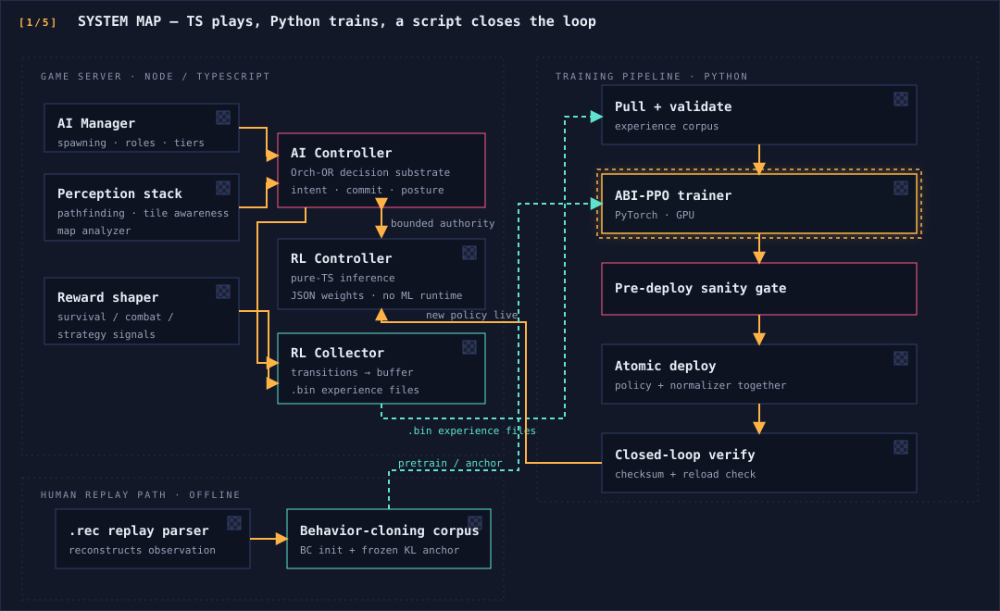
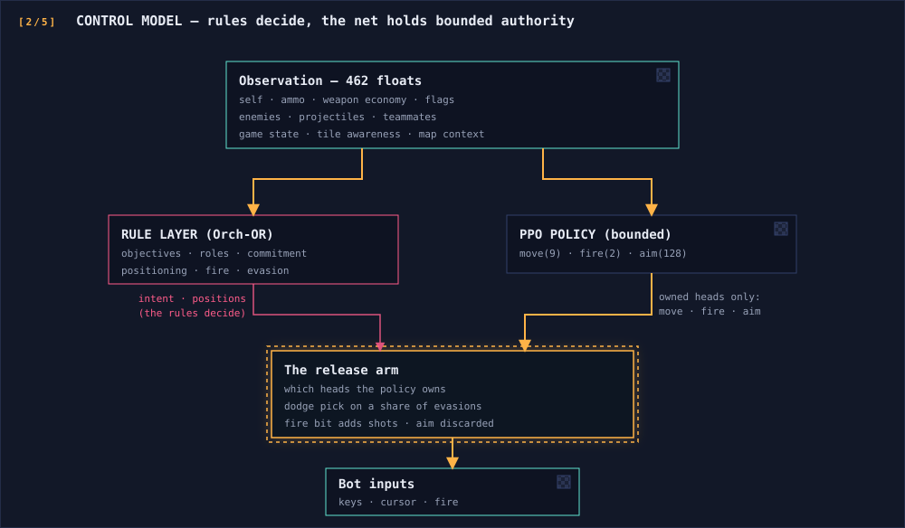
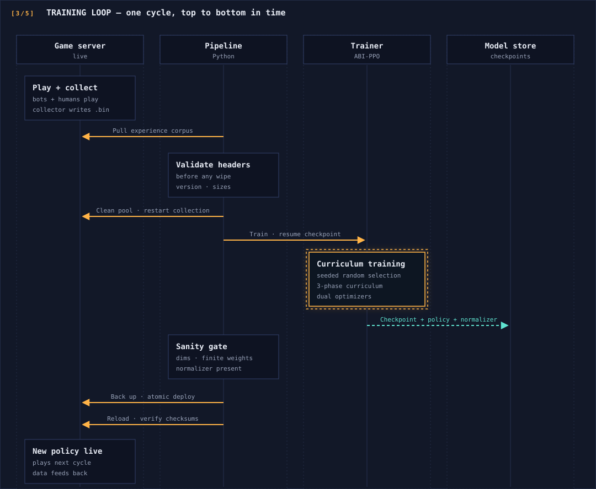
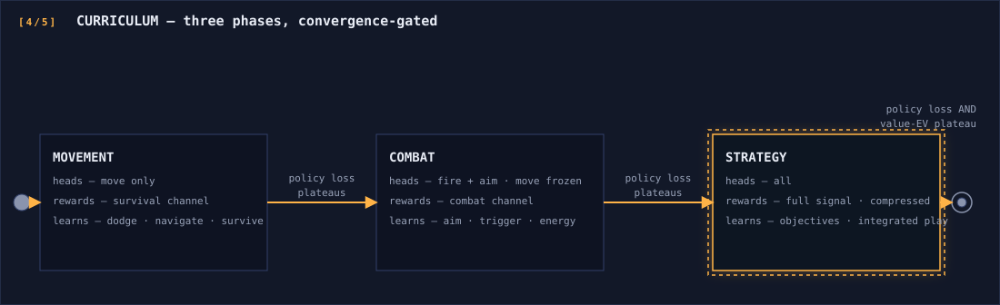
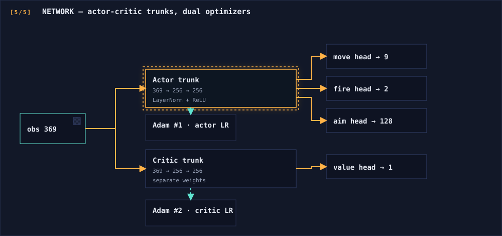

# ABI-PPO — System Architecture

High-level architecture of the ARCbound Intelligence stack. Everything below is
a conceptual description of the private implementation; the novel algorithms
are characterized by what they do, not how they are coded.

---

## 1. Component layout

Three languages, three jobs: TypeScript plays the game, Python trains, and a
pipeline script closes the loop between them.

Key property: the inference engine is dependency-free TypeScript. The trainer
exports weights as JSON; the server loads them, runs the forward pass at game
tick rate, and a dimension guard rejects any policy whose input width is not
one of the observation layouts the runtime knows (bots fall back to pure rules).

---

## 2. The two-layer control model

The rules decide; the PPO policy holds bounded authority over a few heads. In
every room with player-vs-player bots the rule layer is the Orch-OR decision
substrate (since September 2026): it scores candidate objectives, holds and
commits them, posts the squad and decides when to fire. Each numbered release
is an *arm* — a set of rule components plus the list of heads the policy owns.

- **Movement** belongs to the rules. In the current release the net's move
  head picks the dodge on a share of evasion windows, among moves that clear
  every incoming shot.
- **Aim** is *relative*: the rules compute the firing solution, and the net can
  predict a bounded correction around it (128 bins across ±90°). The current
  release discards it after a 194-map study found it cost the exchange.
- **Fire** is binary from the net and can only *add* shots to the rule layer's
  own fire decision. Weapon *selection* stays rule-based and ballistics-aware
  (line-of-sight for hitscan, bank-shot solving for bouncing projectiles, arc
  validation for lobbed ones).
- Legacy bots, on the older per-role state machine, still blend the net's
  movement and aim by an influence dial scaled by difficulty tier.

---

## 3. Training loop data flow

The full production cycle, end to end:

Design intents worth noting:

- **The environment is the game itself.** There is no simplified simulator:
  experience comes from live rooms and from a headless harness that runs the
  same server code many times faster than real time, so corpus hygiene
  (validation before wipes, pull-loss abort thresholds, a structural audit gate
  on every corpus, each batch reflecting one policy) is a first-class concern.
- **A model is judged before it ships.** The same harness flies a candidate
  against the live policy on opposite squads of the same matches, sides
  swapped, against verdict bars set before the run.
- **A broken policy cannot ship.** The pre-deploy gate mirrors the runtime's
  own dimension guard; policy and normalizer deploy atomically as a pair; the
  go-live check is closed-loop (on-disk checksums compared to the training
  output, not a log grep). One command rolls back to any snapshot.

---

## 4. Curriculum stages

Three phases, each mastering one skill before the next unlocks. Transitions
are convergence-driven, not scheduled.

Each phase carries its own reward filter, head mask, learning rates, entropy
pressure, and convergence detector. Three subtleties:

- **The learning rate is checked, not assumed.** An October 2026 audit found
  that each phase's rate had applied only in its first epoch (its schedule was
  built before the rate was written), so every policy had trained at one rate
  pair. The schedule now holds the phase rate on every epoch and a tripwire
  stops a run whose optimizers drift off it. An A/B of the designed per-phase
  rates against that de-facto pair, trained on the same data and judged in
  head-to-head trials, tied, so every phase now declares the de-facto pair.

- **Terminal-reward compression is monotonic.** Large terminal rewards are
  compressed to tame advantage explosions, but strictly order-preservingly —
  win > capture > grab > kill must survive compression. (An earlier
  non-monotonic clip inverted that ordering and taught bots that grabbing beat
  winning; the fix is one of the project's hard-won lessons.)
- **The critic-priority phase gates on explained variance**, not just policy
  loss, so the slow long-horizon value head can't be cut off by the fast
  policy head converging first.

---

## 5. Network and observation contract

The observation is a versioned contract shared byte-for-byte between the
TypeScript encoder and the Python trainer — **462 floats in thirteen blocks**
(layout v12):

| Block | Floats | What it describes |
|---|---|---|
| Self | 8 | position, velocity, health, energy, heading, alive |
| Ammo | 3 | special-weapon charges |
| Weapon economy | 6 | which weapons are affordable right now, sustained-fire budget, regen bonus |
| Objective & role | 18 | flag carried, nearest flag, scoring pole, enemy carrier, carrier to escort, role point, the role the rule layer assigned, team carries |
| Enemies | 42 | the 7 nearest opponents: relative position, velocity, alive (turrets too, in turret-assassin) |
| Aim error | 1 | heading error to the nearest opponent |
| Projectiles | 50 | the 10 nearest incoming shots: relative position, velocity, how directly each is heading at the ship |
| Teammates | 24 | the 4 nearest living teammates: relative position, velocity, health, carrying |
| Game state | 4 | score difference in the mode's own currency, nearest ally, round clock at two time scales |
| Tile awareness | 114 | a hull-sized passability grid around the ship, 16 wall raycasts, conveyor drift |
| Map context | 86 | the static map digest: mode, topology flags, arena scalars, coarse wall-density grid, objective anchors |
| Committed intent | 13 | the plan the rule layer's decision substrate committed this bot to, its target, its urgency |
| Match context (v12) | 93 | respawn pens, position in the playable frame, own team, the match clock, counts past the list caps, teammates' roles and which are human, enemies' pens and flags, mode state, home-pole anchors |

Only one float is purely about aim; about two-fifths describe terrain and the
map. The intent block (v11) lets the net condition on the strategy it is
serving rather than guess it from positions, and the v12 block adds the match
facts an earlier audit found the observation could not show.

Version bumps append — they never reorder — and both ends enforce the width, so
mismatched artifacts are rejected rather than silently misread. When a slot's
*meaning* is corrected without moving it (say, a clock that was measured from
the wrong origin), a separate semantics version records it, and a policy is fed
exactly the semantics it was trained on until a retrained one ships. Experience files carry a self-describing
header (count, observation size, action size, version) for the same reason, and
the current format also records each reward's channel split alongside the scalar
it sums to, so the trainer reads a reward's provenance instead of inferring it.

---

## 6. Runtime AI beyond the net

The rule layer is a substantial system in its own right (~36 K lines of
TypeScript across the runtime AI). Since September 2026 a utility-scoring
decision substrate, *Orch-OR*, is the production rule layer in every room with
player-vs-player bots: candidate objectives are scored and held until the world
resolves them or a bounded strain register forces a commit, roles are assigned
as a covering problem, and a positioning doctrine measured on human replays
(push on an alive edge, protect a late lead, hold the round-start pad, leave the
base unless it is pressed) sets the squad's posture. Each new component is
measured against the previous release in the head-to-head harness before it
ships. The older
per-role state machine still drives legacy bots: role assignment with
hysteresis, carrier interception that paths *ahead* of a flag carrier, per-mode
objective doctrines, curated per-map attack lanes, per-opponent shot-angle dodge
tracking and combat-aware stuck recovery. All of it is covered by unit tests
that run the real map grids.
